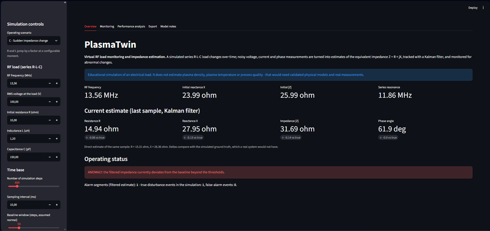
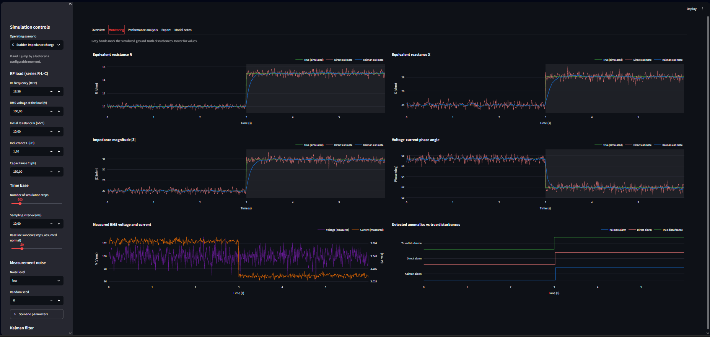
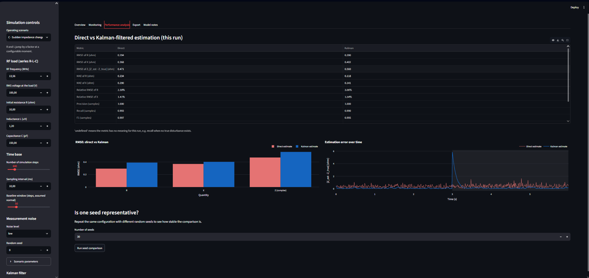

# PlasmaTwin: Virtual RF Load Monitoring and Impedance Estimation

PlasmaTwin is a software project that simulates an RF electrical load, generates noisy voltage, current and phase
measurements, estimates the load's equivalent complex impedance from them, tracks its changes over time with a Kalman filter,
and flags abnormal behaviour. Every result is checked against simulated ground truth with quantitative error metrics,
and every experiment is seeded and reproducible.

> **Scope.** This is an educational simulation of electrical load behaviour. It does **not** estimate plasma density,
> plasma temperature or process quality. That would require validated physical models and real experimental data.



## Contents

[Problem statement](#problem-statement) · [Motivation](#motivation) · [Key features](#key-features) ·
[Mathematical model](#mathematical-model) · [Architecture](#system-architecture) · [Installation](#installation-windows-vs-code) ·
[Running](#running-the-application) · [Scenarios](#simulation-scenarios) · [Screenshots](#screenshots) · [Testing](#testing) ·
[Validation](#validation-methodology-and-results) · [Limitations](#known-limitations) · [Future work](#future-improvements)

## Problem statement

An RF generator delivers power to a load whose impedance is not constant. From measurements of RMS voltage, RMS current and
their phase difference, can the equivalent complex impedance $Z = R + jX$ be estimated reliably, tracked over time despite
measurement noise, and can sudden or abnormal changes be detected quickly without raising false alarms?

## Motivation

In industrial RF power delivery, for example RF supplies used in plasma processing, the load impedance changes with operating
conditions, and a mismatch between source and load reflects power. As an illustration with the default load
(Z ≈ 10 + j24 Ω) driven from an unmatched, purely resistive 50 Ω source, the reflection coefficient is |Γ| ≈ 0.72, so about
52 % of the incident power would be reflected. Monitoring the impedance and noticing when it changes is a basic building
block for controlling and protecting such systems. This project explores that building block in software, on synthetic data.

## Key features

* Series R-L-C equivalent load with documented default values (13.56 MHz, R = 10 Ω, L = 1.2 µH, C = 150 pF).
* Five time-dependent scenarios: stable, gradual drift, sudden step, increasing measurement noise, intermittent disturbances.
* Configurable, seeded measurement noise on voltage, current and phase.
* Two estimators: a direct one (from V, I and phase) and a Kalman filter on [R, X] whose measurement covariance is derived by error propagation.
* Transparent rule-based anomaly detector evaluated against ground-truth labels: detection delay, missed events and false alarms.
* Metrics that report `undefined` instead of returning a misleading number.
* Interactive Streamlit dashboard with Plotly charts; export of results (CSV), configuration (JSON) and a Markdown summary report.
* Automated unit tests and three reproducible numerical experiments.

## Technology stack

Python 3.11+, NumPy, SciPy, Pandas, Plotly, Streamlit, Pytest. No cloud services, paid APIs or special hardware.

## Mathematical model

$$X = \omega L - \frac{1}{\omega C},\qquad Z = R + jX,\qquad |Z| = \frac{V_{rms}}{I_{rms}},\qquad \varphi = \mathrm{atan2}(X, R)$$

$$R_{est} = |Z_{est}|\cos\varphi_m,\qquad X_{est} = |Z_{est}|\sin\varphi_m$$

At a single frequency only R and X are identifiable. L and C cannot be recovered separately, so they are used only to
generate the simulation. The Kalman filter tracks the state $x = [R, X]^T$ with a random-walk model
($F = H = I$, $Q = q^2 I$) and a time-varying measurement covariance obtained by first-order error propagation of the
V, I and phase noise; this is an approximation, documented in the model description.
Full derivation, assumptions and approximations: [docs/mathematical_model.md](docs/mathematical_model.md).

## System architecture

```
plasma-twin/
├── app.py                    Streamlit dashboard (widgets -> configuration -> pipeline -> charts)
├── src/
│   ├── physics.py            R-L-C model, impedance, phase, ideal V/I
│   ├── measurements.py       noise model
│   ├── simulator.py          scenarios A-E and ground truth
│   ├── estimators.py         direct estimator
│   ├── kalman_filter.py      Kalman filter and measurement covariance
│   ├── anomaly_detection.py  rule-based detector
│   ├── metrics.py            error, detection and step-response metrics
│   ├── pipeline.py           end-to-end run, multi-seed comparison
│   ├── report.py             tables, CSV/JSON export, summary report
│   └── visualization.py      Plotly figures
├── tests/                    pytest unit tests
├── experiments/              reproducible validation experiments 1-3
├── examples/                 example configuration (JSON)
└── docs/                     model, architecture, limitations, validation results
```

Numerical code is separate from the user interface; `app.py` contains no estimation logic. Details: [docs/architecture.md](docs/architecture.md).

## Installation (Windows, VS Code)

1. Install Python 3.11 or newer from python.org (tick **Add python.exe to PATH**).
2. Open the project folder in VS Code, open a terminal in it, and run:

```powershell
python -m venv .venv
.venv\Scripts\activate
pip install -r requirements.txt
```

If PowerShell refuses to run the activation script, run `Set-ExecutionPolicy -Scope CurrentUser RemoteSigned` once and try again.

To start from the repository itself:

```powershell
git clone https://github.com/badesalman/plasma-twin.git
cd plasma-twin
```

## Running the application

```powershell
streamlit run app.py
```

A browser tab opens at http://localhost:8501 (if Streamlit asks for an e-mail address on first start, press Enter).
Choose a scenario and parameters in the sidebar; the dashboard updates immediately. It has five tabs:
**Overview** (current estimates and operating status), **Monitoring** (six interactive charts), **Performance analysis**
(direct vs Kalman metrics and a multi-seed comparison), **Export** (CSV, JSON, Markdown summary) and **Model notes**.

## Simulation scenarios

| Scenario | What happens | What it shows |
|---|---|---|
| A - Stable | R and L constant | filtering reduces noise; any alarm is a false alarm |
| B - Drift | R and L change slowly | the filter tracks slow change; detection once the drift has accumulated |
| C - Step | R ×1.5 and L ×1.04 at mid-run | response time and detection delay |
| D - Noisy | load constant, noise ramps up to 4× | robustness; exposes a weakness of the detector (see limitations) |
| E - Intermittent | three temporary disturbances | repeated detection and filter lag at fast changes |

An example configuration is provided in [examples/example_config.json](examples/example_config.json).

## Screenshots

| Overview | Monitoring |
|---|---|
|  |  |

| Performance analysis |
|---|
|  |

The screenshots show the default configuration with the *Sudden impedance change* scenario at low noise.
Grey bands mark the simulated ground-truth disturbance.

## Testing

```powershell
pytest
```

The tests cover impedance calculations for known R-L-C values, purely resistive, inductive and capacitive cases, noiseless
estimation, deterministic simulation for a fixed seed, stable and sudden-change scenarios, Kalman filter numerical stability,
invalid input handling, anomaly thresholds, and the error and detection metric formulas. The Kalman measurement covariance is
additionally checked against a Monte-Carlo simulation.

## Validation methodology and results

Three experiments, all seeded; run them from the repository root:

```powershell
python -m experiments.exp1_noiseless_validation
python -m experiments.exp2_noise_reduction
python -m experiments.exp3_step_response
```

The complete, unedited outputs are in [docs/validation_results.md](docs/validation_results.md). Experiments 2 and 3 use 50 seeds and the
default configuration. Main findings:

* **Experiment 1 - noiseless validation.** Over 144 combinations of frequency, R, L and C, the direct estimator reproduces R and X to about 1e-12 Ω, which is floating-point rounding.
* **Experiment 2 - direct vs Kalman.** Mean complex-impedance RMSE (direct → Kalman) at medium noise:

  | Scenario | Direct | Kalman |
  |---|---|---|
  | Stable | 0.861 Ω | 0.189 Ω |
  | Drift | 0.965 Ω | 0.304 Ω |
  | Increasing noise | 2.208 Ω | 0.553 Ω |
  | Step | 0.962 Ω | 0.832 Ω |
  | Intermittent | 0.892 Ω | 1.611 Ω |

  The filter does **not** always win: at low noise the step scenario gives 0.481 Ω (direct) vs 0.564 Ω (Kalman), because the filter lags behind a sudden change.
  A sweep of the process noise q shows the trade-off: q = 0.005 gives 0.105 Ω on a stable load but 2.535 Ω on a step; q = 0.2 gives 0.347 Ω and 0.521 Ω.
* **Experiment 3 - step response and detection.** At low noise the direct estimate is within half the step size immediately, while the Kalman estimate needs 6.1 samples on average.
  Both detectors found the step in 50 of 50 runs (mean delay 2.0 vs 3.0 samples). At high noise the direct detector found it in 42 of 50 runs and the Kalman-based one in 50 of 50.
  On a stable load there were no false alarms at low and medium noise (at high noise: none for the direct estimate, 2 of 50 runs for the Kalman estimate).
* **Weakness found.** In scenario D (stable load, rising noise) both detectors raised false alarms in most runs (32 to 50 of 50), because their thresholds are calibrated on the initial noise level and the detector cannot tell rising noise from a real load change.

## Known limitations

Full list: [docs/limitations.md](docs/limitations.md). In short:

* Simplified series R-L-C load; no plasma physics, no non-linearity, no matching network.
* Single frequency, so only R and X are identifiable.
* Idealised voltage source at the measurement plane.
* Modelled (not calibrated) Gaussian noise; no systematic errors such as probe calibration or phase error.
* The Kalman measurement covariance is a first-order approximation, and the filter assumes a random-walk state, which causes lag after sudden changes.
* The anomaly detector is rule-based, not a trained model, and it confuses growing measurement noise with a load change.

## Future improvements

* Noise-aware detection (sliding-window variance, or a test on the Kalman innovations) so that rising noise is not reported as a load change.
* Adaptive process noise or a multiple-model filter to reduce lag after steps while keeping smoothing in quiet periods.
* Multi-frequency measurements, to explore which additional parameters become identifiable.
* Reflection coefficient, VSWR and a matching-network model.
* Validation on real voltage-current probe or network-analyser data, including calibration and systematic errors.

